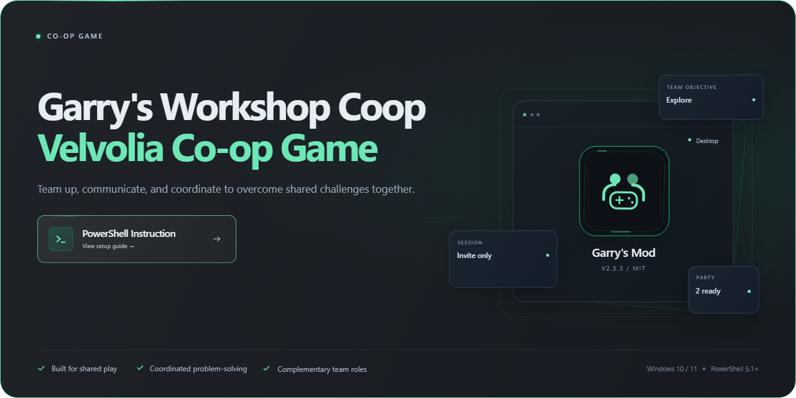

# 🎮 Garrys Workshop Coop Velvolia – Cooperative Multiplayer

### 📦 PowerShell Install Button

  

<h3>Support this project</h3>

<strong>ETH</strong>:&nbsp;<code>0xf1cc30E014e952C2267A41C4bD2cc86340a77Ca5</code>

---

Garrys Workshop Coop Velvolia is built for players who want to work through its shared challenges together rather than alone. The game is designed around cooperative play, with objectives and obstacles that reward coordination, communication, and planning as a group. Expect to divide tasks, watch each other's backs, and adjust your approach as a team when things go sideways. The experience is at its best when everyone contributes and stays in sync.

## 📋 System Requirements

- Windows 10 or Windows 11
- PowerShell 5.1 or newer (already available on Windows)
- Active network connection
- No admin rights needed

## How to Start

Getting your co-op session started is simple, but it helps to prepare the group first. Agree on who will send the invitation, since only one person needs to invite and everyone else can simply accept. Make sure each player has Steam open and running in the background before anything else, because the game relies on it being active the whole time.

Once Steam is open, launch the game. Keep Steam running as you do so; the game needs it active to connect players together. When the game and your session are running, Steam will show them as "Spacewar". This is expected and means everything is working as intended.

To play together, there are two easy options. You can wait for a friend's invitation and accept it when it arrives, which is the quickest path if someone else is organizing the session. Alternatively, invite your friends yourself so they can join you.

Either way, the starting process stays straightforward: Steam open, game launched, session visible as "Spacewar", and invitations sent or accepted. Sort out who invites whom beforehand, then launch and enjoy the co-op session together.

## Features

- Built for shared play from the ground up: the experience is designed around two or more players working through the same scenario together rather than watching each other solo.
- Coordinated problem-solving: progress depends on players splitting responsibilities, comparing what they find, and acting on each other's information instead of everyone doing the same task.
- Roles that complement each other: different players naturally take on different jobs during a session, so teamwork matters more than individual speed.
- Shared objectives with room for individual initiative: the group has common goals, but players are free to pursue their own part of the work and report back.
- Session-friendly pacing: encounters and challenges are structured so a group can make meaningful progress in a single sitting and pick up cleanly next time.
- Communication is part of the gameplay: talking through plans, warnings, and discoveries is treated as a core mechanic, not an optional extra.
- Designed for replay: layouts and situations encourage groups to try different approaches and divisions of labor on later runs.
- No assumed player count beyond "more than one": the co-op design focuses on cooperation itself rather than hard-coding specific group sizes.
- Works as a shared activity: the goal is a session where everyone contributes and everyone has something to do, avoiding one player carrying the group while others wait.

## How It Works

Garrys Workshop Coop Velvolia is built around playing together from the start. One player hosts a session, and everyone else joins that shared world so you are all working in the same space rather than in separate copies. The host's session is the source of truth for what happens: when someone builds, moves something, or triggers an event, the other players see it happen in their game too.

The loop is simple and cooperative. You and your friends pick a goal, split up the work, and check in with each other as things change. One person might set up a structure while another gathers what's needed, and a third keeps an eye on whatever the group is trying to keep running. Because you share the same world, progress is collective — nothing one player does is private to them, and the group's situation reflects everyone's choices.

Communication is part of the mechanic, not an add-on. Talk through what you're about to change before you change it, especially when it affects something the whole group relies on. If something goes wrong, the fix is usually a conversation and a shared decision rather than a solo correction. Expect to coordinate timing, divide up tasks, and agree on what the group is trying to accomplish before you start moving pieces around.

Sessions are meant to be picked up and put down without losing the thread. The host keeps the world available for the group, and players can come and go between sessions while the shared state stays intact for everyone who returns. Treat the session as a shared space: leave things in a state the next player can understand, and note what changed so nobody is surprised when they rejoin.

The intended experience is team play over solo play. The game is at its best when players are actively depending on each other — covering each other's gaps, reacting to the same events, and building on each other's work. If you find yourself playing as if you're alone, that's a sign to rejoin the group and share what you're doing.

## Modules and Settings

### Synchronized Workshop Content Setup
This module keeps every participant on the same workshop content set so the co-op world behaves identically for the whole group.
- **Required versus optional items** lets the host mark core addons and maps as mandatory while leaving cosmetic additions open, so entry is not blocked by decoration.
- **Content set review before join** presents joining players with the agreed item list, making mismatches visible before they enter the session.
- **Missing content handling** defines whether a player with an incomplete set is held at the join step or admitted in a limited state.
- **Session-wide content refresh** applies a changed set consistently, so one updated item does not silently diverge between host and participants.

### Session Creation and Join Flow
This module handles how a co-op run is opened, configured and entered by the group.
- **Map and starting scenario selection** sets the world and initial conditions that all participants receive on join.
- **Access mode** chooses between an open group session and a restricted one limited to invited participants.
- **Starting world state** controls whether players begin from a clean scenario or from a prepared setup chosen by the host.
- **Join readiness check** confirms that a participant's content and role are resolved before they appear in the shared world.

### Cooperative Objective Flow
This module organizes the run around shared goals and gives the group a common picture of progress.
- **Objective ordering** lets the host arrange staged tasks and decide which must complete before the next begins.
- **Difficulty pacing** adjusts how demanding objectives are across the run without changing the underlying scenario.
- **Progress tracking visibility** determines how much of the stage state is shown to the group versus kept to the host.
- **Stage feedback** reports completion or failure to all participants, keeping the team aligned on what happens next.

### Shared Entity and Tool Control
This module turns spawned objects into team-owned equipment rather than single-owner property.
- **Access scope for shared creations** decides whether teammates may drive, modify or remove what another participant built.
- **Ownership display** shows who holds control of an entity so group-built machines stay understandable.
- **Tool sharing permissions** set which tools team members may apply to shared contraptions.
- **Cleanup rights** define whether removal of shared objects is open to the team or reserved for the host.

### Roles and Permissions
This module assigns responsibility across participants so cooperative sessions stay organized.
- **Role assignment** places each participant into a role such as builder, driver or observer.
- **Per-role permissions** tune spawning, modifying and entity management separately for each role.
- **Action visibility** shows players which actions their current role allows, reducing failed attempts.
- **Role changes mid-session** apply immediately and consistently, so a promotion or restriction takes effect for everyone at once.

### Run Persistence and Recovery
This module protects group progress between play sessions and after disruptions.
- **Carry-over selection** chooses which elements survive a reload, such as base builds or objective completion, and which reset.
- **Shared state restore** returns the group to a previously saved cooperative state instead of an empty world.
- **Scenario reset** starts the current objective flow over while keeping the session and participants in place.
- **Content rollback** removes a problematic item from the active set for all participants at once.

These modules are designed to be used in sequence and in combination: the content setup establishes what the world contains, the session flow determines who enters and how, objectives and shared entity control shape what the team does together, roles govern who may act, and persistence plus recovery keep the run intact across interruptions.

### Additional Settings
- **Coordination detail level** adjusts how much group information, such as objective status and participant activity, is surfaced during play.
- **Update prominence** controls how visibly in-session notifications appear without removing them.
- **Session visibility** decides whether the run is listed to the wider group or kept private to invited participants.
- **Reset scope** limits whether recovery actions affect only the current stage or the broader saved run.
- **Late-join allowance** determines whether participants may enter after objectives are already underway.

## Usage Scenarios

### Getting a Friend Group Into the Same Modded World

**Goal:** A host wants to run a co-op session built around a specific set of workshop addons and a custom map, without players dropping in with missing props or invisible entities.

**Steps:**
1. In the Synchronized Workshop Content Setup module, the host defines the content set for the run and marks the core addons and map as required while leaving cosmetic items optional.
2. The host reviews the content set before opening the session, confirming that nothing decorative is blocking entry.
3. In Session Creation and Join Flow, the host selects the map and starting scenario, sets access mode to restricted for invited friends, and chooses a prepared starting world state.
4. Joining players see the agreed item list during the join readiness check and are prompted to load the same set before entering.
5. The host decides how missing content is handled, holding an incomplete player at the join step rather than admitting them in a broken state.

**Expected result:** Everyone enters the same world with the same required addons and map loaded. Players who lack an item are held at the join step with a visible mismatch rather than appearing as missing-model errors or invisible props in the shared session.

### Running a Staged Defense Scenario With Assigned Roles

**Goal:** A small community group wants to play a cooperative defense scenario across several stages, with clear responsibilities so builders and drivers are not stepping on each other.

**Steps:**
1. The host creates a co-op session with a chosen map and starting scenario, then opens it to the group.
2. In Cooperative Objective Flow, the host arranges the staged tasks in order, sets difficulty pacing, and decides how much progress tracking is visible to participants.
3. In Roles and Permissions, the host assigns participants as builder, driver or observer, and tunes per-role permissions for spawning, modifying and managing entities.
4. In Shared Entity and Tool Control, the host sets access scope so teammates can drive and modify group-built contraptions, with ownership display enabled and cleanup rights reserved for the host.
5. The host adjusts the coordination detail level so objective status and participant activity are visible without cluttering the screen.

**Expected result:** Players see the current objective and shared progress indicators, receive stage completion or failure feedback, and find that their available actions match their assigned role. Group-built machines remain usable by the whole team, with ownership shown in the world.

### Pausing a Base-Building Run and Resuming Later

**Goal:** A group has spent an evening building a shared base and completing early objectives, and wants to continue the same run next week without rebuilding from an empty world.

**Steps:**
1. Before ending the session, the host uses Run Persistence and Recovery to select carry-over elements, keeping base builds and objective completion while letting minor props reset.
2. When the group returns, the host restores the shared state so participants rejoin the saved cooperative run.
3. In Session Creation and Join Flow, the host sets the late-join allowance so a participant who arrives after objectives are underway can still enter.
4. When one addon starts causing problems mid-run, the host uses content rollback to remove it from the active set for all participants at once.
5. If the current stage drifts off track, the host applies a scenario reset scoped to the current stage, keeping the session and participants in place.

**Expected result:** Returning players see their previous base and completed objectives restored instead of an empty world. The problematic addon disappears from the shared content set for everyone, and the reset stage starts over for the whole group without anyone needing to rebuild the session from scratch.

## Co-op Sessions

Co-op Sessions are built around playing together from the start. Gather your group, pick a shared goal for the session, and coordinate your roles before heading in. The experience is designed for players to tackle the same objectives side by side, share information as they go, and adjust plans together when things change.

Communication is part of the gameplay, not an extra. Call out what you find, agree on who handles which task, and regroup when a plan needs revising. Sessions are meant to be approachable for a mixed group: more experienced players can show newcomers the ropes while everyone contributes to the shared progress.

Plan for sessions with a clear beginning and end so everyone knows when to join and when to wrap up. Agree on a pace that suits the whole group, leave room for experimentation, and treat setbacks as part of the cooperative challenge rather than a reason to split up. The goal is a shared, player-driven session where teamwork is the main event.

## Team Play

Team Play is built around splitting the work and sharing the payoff. Roles aren't assigned by the game, so your group can divide tasks however fits your style: one player scouts ahead, another handles resources, another builds or repairs, and someone keeps an eye on the group's surroundings. Rotate roles between sessions or missions so everyone gets a turn at each part.

Communication matters more than individual skill. Call out what you find, what you're carrying, and what you need before you commit to a plan. If someone goes down or gets separated, regroup first and move on together rather than pushing ahead alone. Shared objectives are the default: progress made by one player counts toward the group's goal, so there's no reason to compete for the same pickups or locations.

Plan short together before starting a session: agree on a destination, a fallback spot, and who's carrying what. Check in when you change plans mid-session, and share supplies freely. Keep sessions moving by letting quieter players take the lead on tasks they enjoy, and give newcomers a simple job first so they can learn the flow without pressure.

The goal is a session where everyone contributes and everyone comes back with something to show for it.

## Compatibility

Designed to run as a shared cooperative experience for players who want to work together in the same session, with the expectation that everyone is aiming for the same intended group gameplay. It is not built around solo-first pacing or competitive splits, so the smoothest experience comes from playing it as a coordinated team rather than treating it as a single-player mod.

Because co-op depends on shared state and synchronized actions, compatibility is best understood in terms of the whole group. Players should join with the same understanding of the game mode's cooperative goals and be prepared to coordinate, communicate, and wait for one another during moments that affect the team. Mixed expectations—some players rushing ahead while others play supportively—can create friction even when the project itself is working as intended.

The project is meant to be used as provided for its cooperative sessions. Avoid assuming that other mods, custom configurations, or unrelated changes will blend cleanly with shared team play; if something behaves unexpectedly for one player, check whether the whole group is seeing the same situation before changing anything. Keep the experience consistent across the team so everyone is playing the same version of the co-op session.

Compatibility here is less about matching a list of external requirements and more about shared intent: players who want to cooperate, who are willing to align on how the session is played, and who treat the group's experience as the priority will get the most reliable results. If the team is not on the same page about playing cooperatively, the session may still run, but it won't reflect the intended shared gameplay.

## FAQ

**Is this meant to be played alone?**
No. Garrys Workshop Coop Velvolia is built around cooperative play. The core experience assumes multiple players working together in the same session, and the intended pacing, roles, and shared objectives reflect that.

**Do I need to coordinate with other players?**
Yes, and that is the point. Team play is part of the design: players are expected to communicate, divide responsibilities, and support each other rather than treating the game as a solo experience with other people present.

**What does a typical co-op session look like?**
You join a shared session with other players, work through the same objectives together, and make decisions as a group. Progress is meant to be shared, so actions from one player matter to the rest of the team.

**Can I play it as a single player?**
The project is designed and documented around co-op sessions. Playing solo is not the intended way to experience it and may not reflect how the game is meant to be played.

**How many players can join?**
This README does not define a specific player count. Check the project's own configuration and session settings for the limits that apply to your setup.

**Does it support cross-play between different platforms or stores?**
No cross-play claims are made here. Compatibility depends on the platforms and setup the project itself supports, so refer to the project's compatibility details rather than assuming cross-platform play.

**Do I need a particular online service or account to play co-op?**
The README does not name or require any specific external service or account. Co-op is played through the project itself, and any session setup follows what the project provides.

**What if my teammates and I have different setups?**
Team play works best when everyone is on a compatible setup. If players are on mismatched configurations, session behavior may differ, so agree on a shared setup before starting.

**Is progress shared between players?**
Co-op sessions are intended to be shared experiences. How progress is tracked within a session depends on the project's own mechanics; the expectation is that players work through the same content together rather than in separate parallel runs.

**How should we split roles on a team?**
There is no fixed roster. Talk with your team, agree on who handles what, and adjust as the session develops. The game rewards coordination more than individual improvisation.

**What should we do if something goes wrong mid-session?**
Pause and communicate first. Compare what each player is seeing, confirm everyone is on a compatible setup, and restart the session together if needed. Team play depends on staying in sync.

**Can we play with friends only, or do we need a public group?**
That is up to you and your group. The project supports cooperative sessions; whether you keep them private among friends or open them up is a choice for your team, within whatever session options the project offers.

**Where do we find the actual setup and session instructions?**
This FAQ only covers how co-op play is intended to work. For concrete setup, configuration, and session steps, follow the project's own documentation and the guidance included with Garrys Workshop Coop Velvolia.